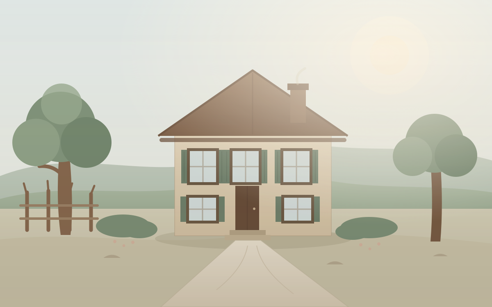

# AVANT LE SILENCE

### Une maison. Des vies. Une mémoire.



**AVANT LE SILENCE** est une expérience narrative documentaire consacrée à la Maison d'Izieu et aux enfants juifs qui y trouvèrent refuge en 1943–1944. À travers des lieux, des archives, des lettres, des dessins et des témoignages, le jeu invite à découvrir leur histoire et le travail de mémoire qui en a préservé les traces.

> **Règle fondamentale :** on ne joue pas avec leur tragédie. On découvre leur histoire.

---

## Statut du projet

**Version 0.8.0 — version candidate.**

Le jeu est complet, jouable de bout en bout et techniquement prêt à être publié sur GitHub Pages. La version 1.0.0 reste conditionnée à deux étapes prévues par le PRD :

1. **Relecture historique** par une personne compétente en histoire de la Shoah ou une institution mémorielle.
2. **Autorisations de reproduction** pour les documents et images d'archives, qui ne sont volontairement **pas intégrés** dans cette version.

Cette version utilise uniquement des illustrations originales, des textes de médiation et des liens vers les sources officielles. Elle ne prétend pas être une publication officielle du Mémorial de la Maison d'Izieu ni de la Bibliothèque nationale de France.

---

## Objectifs du projet

1. Raconter fidèlement l'histoire de la Maison d'Izieu.
2. Donner une place centrale aux enfants et aux adultes qui y ont vécu.
3. Faire découvrir des documents et des sources historiques.
4. Distinguer clairement les faits, les interprétations et les textes de médiation.
5. Comprendre comment la mémoire s'est construite après la guerre.
6. Proposer une expérience émotionnelle sobre, sans manipulation artificielle.
7. Créer un jeu gratuit, accessible et jouable dans un navigateur.
8. Permettre une diffusion internationale à terme, après validation de la version française.

---

## Ce que contient le jeu

- Un prologue et un avertissement de contenu.
- Quatre chapitres :
  - **I — La maison** (mai 1943 – avril 1944)
  - **II — Les traces** (photographies, lettres, dessins, archives)
  - **III — Le 6 avril 1944** (rafle, Montluc, Drancy, convois, destins, témoignage)
  - **IV — Après** (retour, commémoration, procès, archives, mémorial)
- **18 scènes** explorables avec points d'intérêt.
- **16 fiches documentaires** et **8 fiches personnes**.
- **13 repères chronologiques** filtrables.
- Un **carnet de mémoire** avec recherche, filtres et suppression d'éléments.
- **3 ateliers documentaires** :
  - distinguer les preuves ;
  - classer un document ;
  - remettre les événements dans l'ordre.
- Une conclusion personnalisée à partir du carnet.
- Une sauvegarde locale automatique dans le navigateur.
- Des réglages d'accessibilité : taille du texte, contraste élevé, réduction des mouvements, volumes sonores.
- Une ambiance sonore discrète, entièrement synthétisée avec la Web Audio API.
- Un fonctionnement **sans backend**, **sans compte**, **sans collecte de données**, **sans publicité** et **sans achat intégré**.

---

## Jouer

Une fois GitHub Pages activé :

`https://casifox.github.io/avant-le-silence/`

Le jeu est gratuit, sans publicité, sans achat intégré et sans inscription. Aucune installation n'est nécessaire : il suffit d'un navigateur récent.

---

## Compatibilité

| Élément | Cible |
|---|---|
| Navigateurs | Chrome, Edge, Firefox, Safari récents |
| Ordinateurs | Windows, macOS, Linux |
| Mobiles | Android, iOS, tablettes |
| Résolutions testées | 360×800, 390×844, 768×1024, 1280×720, 1366×768, 1920×1080 |
| Technologie | HTML5, CSS3, JavaScript natif, SVG, Web Audio API |
| Backend | Aucun |
| Compilation | Aucune |
| Dépendances externes | Aucune |
| Hébergement | GitHub Pages (branche `main`, dossier racine) |

Les modules JavaScript natifs et les fichiers JSON nécessitent un serveur HTTP pour être testés en local. GitHub Pages fournit ce serveur. Pour un test local, voir la section **Développement**.

---

## Commandes

| Action | Commande |
|---|---|
| Lancer un serveur local (Python) | `python -m http.server 8000` |
| Ouvrir le jeu | `http://localhost:8000/` |
| Lancer un serveur local (Node) | `npx serve .` |
| Valider les données | `python tests/validate_content.py` |
| Vérifier la syntaxe JavaScript | Voir `tests/README.md` (commande PowerShell avec pipe) |

Aucune commande de compilation n'est nécessaire.

---

## Contrôles

| Action | Souris / tactile | Clavier |
|---|---|---|
| Interagir | Clic / appui | `Entrée` ou `Espace` |
| Ouvrir un document | Clic sur un point d'intérêt ou une fiche | `Entrée` |
| Fermer une fiche | Bouton Fermer | `Échap` |
| Carnet | Bouton Carnet | `N` |
| Chronologie | Bouton Chronologie | `T` |
| Navigation | Boutons précédent / suivant | `Tab` puis `Entrée` |

Les raccourcis sont désactivés lorsque vous saisissez du texte.

---

## Accessibilité

- Navigation complète au clavier.
- Focus visible et piège de focus dans les modales.
- Alternatives textuelles pour les illustrations et les documents non reproduits.
- Taille du texte réglable.
- Contraste élevé.
- Réduction des animations, y compris le respect de `prefers-reduced-motion`.
- Aucune information transmise uniquement par la couleur.
- Zones tactiles principales de 44 px sur mobile.
- Avertissement de contenu avant les chapitres difficiles.
- Possibilité de quitter et de reprendre sans perte de progression.

Un audit Lighthouse sur les écrans principaux a obtenu **100 / 100 en accessibilité** (version 0.8.0, Chrome, serveur local). Les tests manuels restent à compléter sur plusieurs navigateurs et lecteurs d'écran.

---

## Structure des fichiers

```text
avant-le-silence/
├── index.html
├── 404.html
├── .nojekyll
├── README.md
├── LICENSE
├── COPYRIGHT.md
├── ASSET_RIGHTS.md
├── SOURCES.md
├── PRIVACY.md
├── CHANGELOG.md
├── CONTRIBUTING.md
├── css/
│   ├── global.css
│   ├── typography.css
│   ├── layout.css
│   ├── interface.css
│   ├── documents.css
│   ├── chapters.css
│   ├── responsive.css
│   └── accessibility.css
├── js/
│   ├── main.js
│   ├── core/
│   │   ├── application.js
│   │   ├── navigation.js
│   │   ├── event-manager.js
│   │   └── state-manager.js
│   ├── systems/
│   │   ├── exploration.js
│   │   ├── document-system.js
│   │   ├── chronology-system.js
│   │   ├── memory-notebook.js
│   │   ├── progress-system.js
│   │   └── audio-system.js
│   ├── ui/
│   │   ├── home-screen.js
│   │   ├── chapter-screen.js
│   │   ├── document-viewer.js
│   │   ├── notebook-ui.js
│   │   ├── chronology-ui.js
│   │   ├── settings-ui.js
│   │   ├── activity-ui.js
│   │   ├── info-screens.js
│   │   ├── page-shell.js
│   │   └── modal.js
│   ├── storage/
│   │   ├── save-manager.js
│   │   ├── save-validator.js
│   │   └── migrations.js
│   └── utils/
│       ├── paths.js
│       ├── accessibility.js
│       ├── validation.js
│       └── helpers.js
├── content/
│   ├── fr/
│   │   ├── chapters.json
│   │   ├── people.json
│   │   ├── documents.json
│   │   ├── timeline.json
│   │   ├── glossary.json
│   │   ├── narratives.json
│   │   └── sources.json
│   └── en/
│       └── README.md
├── assets/
│   ├── backgrounds/
│   ├── icons/
│   └── illustrations/
├── tests/
│   ├── README.md
│   ├── manual-qa.md
│   ├── content-validation.md
│   ├── validate_content.py
│   ├── viewport-360.html
│   ├── viewport-390.html
│   ├── viewport-768.html
│   ├── viewport-1280.html
│   └── fixtures/
└── docs/
    ├── GAME_DESIGN.md
    ├── HISTORICAL_REVIEW.md
    └── RELEASE_CHECKLIST.md
```

Tous les chemins sont relatifs et compatibles avec une URL GitHub Pages de type `https://utilisateur.github.io/avant-le-silence/`.

---

## Sources historiques

La base documentaire initiale est listée dans [`SOURCES.md`](SOURCES.md) et dans [`content/fr/sources.json`](content/fr/sources.json). Les fiches du jeu renvoient aux pages officielles du Mémorial de la Maison d'Izieu et de la Bibliothèque nationale de France.

Sources principales :

1. [Histoire de la Maison d'Izieu — création du musée-mémorial](https://www.memorializieu.eu/le-musee-memorial/la-creation-du-musee-memorial/)
2. [Le 6 avril 1944](https://www.memorializieu.eu/histoire/histoire-pourquoi-des-enfants-juifs-a-izieu/le-6-avril-1944/)
3. [La déportation et l'extermination](https://www.memorializieu.eu/histoire/histoire-pourquoi-des-enfants-juifs-a-izieu/la-deportation-et-lextermination/)
4. [La mémoire et sa construction](https://www.memorializieu.eu/le-musee-memorial/la-memoire-et-sa-construction/)
5. [Les archives](https://www.memorializieu.eu/archives-et-recherches/les-archives/)
6. [Documents et images](https://www.memorializieu.eu/archives-et-recherches/documents-et-images/)
7. [Les enfants d'Izieu — BnF](https://www.bnf.fr/fr/mediatheque/les-enfants-dizieu)
8. [Ouvrage de référence](https://www.memorializieu.eu/nouvel-ouvrage-de-reference/)

> Les documents et images des institutions ne sont pas reproduits dans cette version. Toute reproduction reste soumise à leurs conditions et autorisations.

---

## Crédits

- **Conception, textes de médiation et illustrations originales** : projet AVANT LE SILENCE.
- **Sources historiques** : voir [`SOURCES.md`](SOURCES.md).
- **Polices** : polices système, aucune police externe intégrée.
- **Audio** : synthèse Web Audio API originale, aucun fichier audio externe.
- **Inspiration graphique** : papier, bois, lumière naturelle, espaces d'exposition.

Les illustrations sont des créations originales. Elles ne reproduisent pas des photographies d'époque et ne prétendent pas représenter l'architecture exacte de la Maison d'Izieu.

---

## Droits d'auteur

Le projet utilise une **double licence** :

- **Code** (HTML, CSS, JavaScript, scripts de test) : licence MIT. Voir [`LICENSE`](LICENSE).
- **Textes de médiation, illustrations originales et identité visuelle** : licence Creative Commons Attribution — Pas d'utilisation commerciale — Partage dans les mêmes conditions 4.0 (CC BY-NC-SA 4.0). Voir [`COPYRIGHT.md`](COPYRIGHT.md).

Les documents et images d'archives ne sont pas inclus. Leurs droits restent détenus par leurs auteurs, ayants droit et institutions de conservation. Le registre des ressources est tenu dans [`ASSET_RIGHTS.md`](ASSET_RIGHTS.md).

---

## Confidentialité

Le jeu ne collecte aucune donnée personnelle, n'utilise aucun cookie de suivi, aucun outil d'analyse et aucun compte. La progression est stockée uniquement dans le `localStorage` du navigateur et peut être supprimée depuis les paramètres. Voir [`PRIVACY.md`](PRIVACY.md).

---

## Développement local

Le jeu est un site statique sans build. Pour le tester en local :

```bash
# Depuis la racine du projet
python -m http.server 8000
```

Puis ouvrir `http://localhost:8000/`.

Sous Windows, la commande peut être `py -m http.server 8000`. Une alternative Node est `npx serve .`.

**Pourquoi un serveur local ?** Les modules ES et les appels `fetch` vers les fichiers JSON ne fonctionnent pas correctement avec le protocole `file://` dans la plupart des navigateurs. GitHub Pages fournit un serveur HTTP statique ; le serveur local reproduit ce comportement.

### Validation du contenu

```bash
python tests/validate_content.py
```

Le script vérifie les identifiants, les références croisées, les types de documents et les liens entre chapitres, documents, personnes, sources et événements.

Lors d'un changement de version, mettre à jour :

- `APP_VERSION` dans `js/utils/paths.js` ;
- les paramètres `?v=` des fichiers CSS et du script principal dans `index.html` ;
- `CHANGELOG.md` et les documents de version.

---

## Publication sur GitHub Pages

1. Créer un dépôt public nommé `avant-le-silence`.
2. Placer tous les fichiers du projet à la racine du dépôt.
3. Vérifier que `index.html` est bien à la racine et que `.nojekyll` est présent.
4. Ouvrir **Settings → Pages**.
5. Dans **Build and deployment**, choisir **Deploy from a branch**.
6. Sélectionner la branche **main** et le dossier **/ (root)**.
7. Enregistrer.
8. Attendre la publication, puis ouvrir :
   `https://casifox.github.io/avant-le-silence/`

Aucune compilation, aucun workflow personnalisé, aucun backend et aucun secret ne sont nécessaires.

### Vérifications après publication

- Les chemins CSS, JavaScript, JSON et SVG se chargent.
- Les accents et les caractères spéciaux s'affichent correctement.
- Les modules ES se chargent.
- La sauvegarde locale fonctionne.
- Les liens externes ouvrent les sites officiels.
- Le jeu fonctionne sur mobile.
- La page 404 personnalisée s'affiche pour une URL inconnue.

Voir [`docs/RELEASE_CHECKLIST.md`](docs/RELEASE_CHECKLIST.md).

---

## Tests

- [`tests/README.md`](tests/README.md) : procédure générale.
- [`tests/manual-qa.md`](tests/manual-qa.md) : checklist manuelle.
- [`tests/content-validation.md`](tests/content-validation.md) : validation des données.
- [`tests/validate_content.py`](tests/validate_content.py) : script de contrôle.
- [`docs/HISTORICAL_REVIEW.md`](docs/HISTORICAL_REVIEW.md) : points historiques à vérifier.

---

## Limites connues avant la version 1.0.0

- **Aucune image d'archive n'est reproduite.** Les fiches utilisent des cadres graphiques et des liens vers les sources officielles.
- **Aucune citation de témoignage n'est reproduite.** Les paroles de Léa Feldblum doivent être vérifiées, autorisées et citées avec leur contexte.
- **La liste nominative complète des enfants n'est pas intégrée.** Elle est consultable auprès du Mémorial de la Maison d'Izieu.
- **La relecture historique par un spécialiste n'a pas encore été réalisée.**
- **Les références judiciaires du procès Barbie restent à préciser.**
- **La version anglaise n'est pas commencée.**
- **Les tests multi-navigateurs et lecteurs d'écran restent à compléter.**

Ces limites sont volontaires : le PRD interdit de combler les lacunes par des inventions.

---

## Licence

- Code : MIT.
- Contenus éditoriaux et illustrations originales : CC BY-NC-SA 4.0.
- Documents d'archives : non inclus, droits réservés à leurs institutions et ayants droit.

Voir [`LICENSE`](LICENSE), [`COPYRIGHT.md`](COPYRIGHT.md) et [`ASSET_RIGHTS.md`](ASSET_RIGHTS.md).

---

## Remerciements

Aux personnes qui ont vécu à la Maison d'Izieu, à celles et ceux qui ont conservé leurs traces, et aux institutions qui permettent aujourd'hui de les consulter.

**AVANT LE SILENCE**  
*Une maison. Des vies. Une mémoire.*
